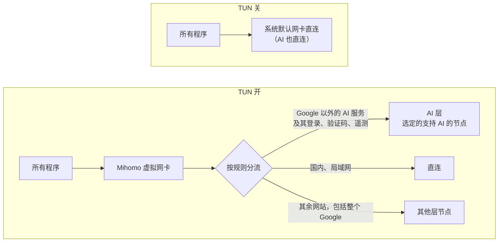

# Clash Verge AI 分流配置

给 Windows / macOS / Linux 上的 Clash Verge Rev 用的一键配置：**AI 服务固定走你选的节点，国内直连，其余走代理**。订阅只当节点来源，改不了你的规则和 DNS。

## 快速开始

**需要**：Clash Verge Rev（装好后至少打开过一次），和至少一个订阅链接。

1. **导入订阅**：Clash Verge 订阅页 → New → Remote，粘贴链接。导入后不要启用，也别删。
2. **运行脚本**：打开脚本文件（[Windows](Setup-ClashAI.ps1) / [macOS](setup-clash-ai-macos.sh) / [Linux](setup-clash-ai.sh)），点「Download raw file」下载，不要复制粘贴。运行前先通读一遍。运行时按提示选，不确定就直接回车。
   - Windows：在脚本所在文件夹打开**管理员** PowerShell，运行

     ```powershell
     powershell -ExecutionPolicy Bypass -File .\Setup-ClashAI.ps1
     ```

   - macOS：打开「终端」，cd 到脚本所在文件夹，用普通用户运行（系统自带的 bash 就行），需要管理员的步骤脚本会自己调用 sudo。加 `--restart-clash`，脚本会自己退出 Clash Verge，改完再打开

     ```bash
     bash setup-clash-ai-macos.sh
     ```

   - Linux：用普通用户运行，需要 root 的步骤脚本会自己调用 sudo

     ```bash
     bash setup-clash-ai.sh
     ```

3. **选节点、开 TUN**：打开 Clash Verge，在代理页**给 AI 组选一个节点**（AI 组默认是「拒绝」，不选的话 AI 打不开）；「其他」组选一个能正常用 Google 的节点，Gemini 跟着它走。再回首页打开 TUN（虚拟网卡模式）。

**怎么算配好**：再运行一次脚本，Windows 加 `-Verify`，macOS / Linux 加 `--verify`，结果里没有「失败」就算配好。要用浏览器访问 AI 的，再按[浏览器防泄露](#浏览器防泄露)设置一下。

只想先看看会生成什么、不改任何东西：Windows 加 `-DryRun`，macOS / Linux 加 `--dry-run`。

---

以下是详细说明。

## 它做了什么



| 策略组 | 管什么 |
| --- | --- |
| AI | Google 以外的 AI 服务，以及它们的登录、验证码、遥测。第一项是「拒绝」，后面只列支持 AI 的地区的节点；选中的节点不见了就断开，不会悄悄换出口 |
| 其他 | 其余需要代理的网站，包括整个 Google（Gemini 也在内），所以要选一个能正常用 Google 的节点 |
| DNS | Clash 自己查境外域名时用哪个节点。默认跟「其他」走，也可以单独选 |
| GLOBAL | 首页切到「全局」时用。默认跟「其他」走，选 AI 就一切走 AI 节点 |
| 广告拦截 | 开关：PASS = 关（默认），REJECT = 开 |

- **规则**：先拒绝 HTTP/3（浏览器会改用普通 HTTPS），再把 Google 整个交给「其他」层，然后把 AI 清单交给 AI 层（自带的 Claude 清单、MetaCubeX 的 AI 列表、Anthropic 的 IP 段）。其余按 Loyalsoldier 的规则：国内和局域网直连，境外走「其他」，必应也整个走「其他」。
- **为什么 Google 整个走「其他」**：Gemini、AI Studio、Google 登录都算在内。Google 按账号判断地区，同一个账号的请求要从同一个出口出去。上游还把 Google 和必应一部分国内能连的域名放进了直连，这些请求带着账号 Cookie，会让对方看到你的真实 IP，把账号当成在国内。
- **DNS**：用 fake-ip。走代理的域名由节点在远端解析，所以 AI 域名的解析也是从 AI 节点发出的。Clash 自己要查的部分：国内域名直连阿里 / 腾讯的加密 DNS，其余经 DNS 层节点查 Cloudflare / Google。DNS 只监听本机。
- **时区**：设成和 AI 节点所在地一致，并开启自动对时。

## 脚本选项

| 启动时问的 | 默认 | 参数（Windows / macOS、Linux） |
| --- | --- | --- |
| 用哪些订阅（序号或名字，逗号分开） | 全部 | `-Subscriptions` / `--subscriptions` |
| 每个订阅的 AI 节点关键词，区分大小写，如 `GPT`、`新加坡\|台湾` | 按支持 AI 的地区 | `-AiKeywords` / `--ai-keywords`，按订阅顺序用分号隔开 |
| 时区 | 新加坡 | `-TimeZone 'Singapore Standard Time'` / `--timezone Asia/Singapore` |
| 广告拦截默认开不开 | off | `-AdBlock` / `--adblock` |
| 双出口 | no | `-DualExit no\|all\|split` / `--dual-exit`，见[双出口](#双出口可选) |

其他参数：
- `-Yes` / `--yes`：执行前不再确认。
- `-SkipSystem` / `--skip-system`：只改 Clash，不动时区和网卡。
- `-ClashDir` / `--clash-dir`：配置目录不在默认位置时用。
- `--mihomo`（macOS、Linux）：检查配置用的内核不在默认位置（Linux 是 `/usr/bin`，macOS 是 Clash Verge.app 里）时用。
- `--restart-clash`（仅 macOS）：由脚本退出 Clash Verge，改完再打开，不用自己去菜单栏退出。

**会改什么**：
- Clash Verge 的 `config.yaml`：关 IPv6，TUN 开启自动路由和严格路由。
- `verge.yaml`：关 DNS 覆写、关系统代理。
- 全局扩展覆写配置：重写。
- 「组合配置」：新建或更新，并设为当前配置。
- 系统：时区和自动对时；选了双出口时，还会改网卡的跃点数，并关掉 Clash 出口的 IPv6。

改之前会全部备份到 Clash Verge 配置目录下的 `setup-backup-时间` 文件夹，把里面的文件拷回去就能恢复。脚本不会禁用网卡，不碰订阅链接，也不替你选 AI 节点。

**Windows**：PowerShell 5.1 只认带 BOM 的 UTF-8 脚本，复制粘贴会让中文变成乱码。实在要粘贴，记事本另存为时编码选「带有 BOM 的 UTF-8」。

**macOS**：
- 配置目录是 `~/Library/Application Support/io.github.clash-verge-rev.clash-verge-rev`。
- 时区用 systemsetup 设置，并关掉「根据位置自动设置时区」，不然系统会按所在地把时区改回去；对时服务器改成 ntp.aliyun.com，并开启自动对时。和现在一样的设置不会去改，都一样时不要管理员密码。
- 双出口：macOS 没有跃点数，改的是「网络服务顺序」（默认出口排第一，Clash 出口排最后），再用 networksetup 关掉 Clash 出口那个网络服务的 IPv6。
- 服务模式下内核在另一个目录里运行，实测组合配置里订阅文件的相对路径照样能读到。
- `--verify` 比另外两版多查三项：各组选的节点、浏览器等程序用的系统 DNS 有没有被 Clash 接管、「根据位置自动设置时区」有没有关。
- macOS 版在 macOS 27 + Clash Verge Rev 2.5.8（服务模式）上实测过；双出口和需要管理员的系统设置还没在真机上跑过。

**Linux**：
- 配置目录是 `~/.local/share/io.github.clash-verge-rev.clash-verge-rev`。
- 时区用 timedatectl 设置；对时写入 `/etc/systemd/timesyncd.conf.d/50-clash-ai.conf`，删掉它就恢复；双出口要用 NetworkManager。
- Linux 版只在 WSL 里测过，NetworkManager 部分和 TUN 开着时的验证还没在真机上跑过。

## 双出口（可选）

电脑同时连着两个网络时，可以让流量分开走。比如网线接的校园网连不上代理节点，手机热点能连上。两个出口各用哪块网卡由你选：

- **默认出口**：系统默认走的那块，关 TUN 时一切走它。
- **Clash 出口**：Clash 连代理节点用的那块。

| | all | split |
| --- | --- | --- |
| 开 TUN 时 | 一切经 Clash 从 Clash 出口出去 | 直连走默认出口；代理（所有节点）走 Clash 出口 |
| 关 TUN 时 | 一切走默认出口 | 一切走默认出口 |
| Clash 出口断了 | 全部断网，不会退回默认出口 | 只有直连的国内网站能用，代理和 AI 都断 |
| 局限 | 国内网站和局域网也走 Clash 出口，用热点时会耗流量；开着 TUN 时，访问不到默认出口那边的局域网设备 | 默认出口那边的网络能看到你访问了哪些国内网站，以及你在用阿里 / 腾讯的 DoH（看不到代理流量）；默认出口断了，直连会改走 Clash 出口 |

两种模式下，脚本都会：
- 把默认出口的跃点数设成 1、Clash 出口设成 500（macOS 上是把默认出口排在网络服务顺序的第一位，Clash 出口排最后）；
- 关掉 Clash 出口的 IPv6，否则关 TUN 时 IPv6 流量可能从它出去；
- 局域网域名用直连那一侧的 DNS 解析。

Clash 出口是 Wi-Fi 时，它断开后可能自动连上别的已保存网络；不想这样，就把其他 Wi-Fi 改成手动连接。

验证时，all 模式检查默认出口基本不发数据；split 模式会分别下载 1 MB，看代理流量和直连流量各从哪块网卡进来，会用掉 Clash 出口约 1 MB 流量。

## 浏览器防泄露

浏览器有几条绕开 Clash 的路，用浏览器访问 AI 前要自己关掉：

| 要做的事 | 为什么 | Chrome / Edge | Firefox |
| --- | --- | --- | --- |
| 关掉安全 DNS（DoH） | 浏览器自己查 DNS 会绕过 Clash 的 DNS 分流，还可能用 ECH 把域名藏起来，Clash 就没法按域名分流 | 设置 → 隐私和安全 → 安全 →「使用安全 DNS」（Edge：隐私、搜索和服务 → 安全性） | 设置 → 隐私与安全 →「基于 HTTPS 的 DNS」选「关闭」 |
| 限制 WebRTC | 网页能用它探测你的 IP；探测服务器在国内时，请求会直连出去，暴露真实 IP | 装 Google 的「WebRTC Network Limiter」，选「Disable non-proxied UDP」（网页视频通话可能受影响） | `about:config` 里把 `media.peerconnection.enabled` 设成 `false` |
| 关掉 HTTP/3 | 组合配置已经拒绝它，浏览器里也关掉，就不用每次先试一下 | `chrome://flags/#enable-quic`（Edge：`edge://flags/#enable-quic`）设为 Disabled | `about:config` 里把 `network.http.http3.enable` 设成 `false` |
| 关掉浏览器自带的 VPN 或代理 | 开着的话，出口就不是 Clash 选的节点 | 关掉这类功能和扩展 | 同左 |

**测一遍**：开着 TUN，保持「规则」模式，用访问 AI 的那个浏览器打开下面几个网站。

- [ ] WebRTC：[browserleaks.com/webrtc](https://browserleaks.com/webrtc) 里不应出现本地网络的公网 IP
- [ ] DNS：[browserleaks.com/dns](https://browserleaks.com/dns) 或 [ipleak.net](https://ipleak.net) 列出的 DNS 服务器里不应有国内的（电信、联通、移动、阿里、腾讯、114 等）；「DNS 和出口 IP 不在同一地区」这类提示可以不管
- [ ] IPv6：[test-ipv6.com](https://test-ipv6.com) 显示没有 IPv6 地址
- [ ] HTTP/3：[cloudflare-quic.com](https://cloudflare-quic.com) 显示用的是 HTTP/2

这些网站走的是「其他」层，显示的是「其他」层节点的 IP。AI 的出口看 `https://claude.ai/cdn-cgi/trace` 里的 `loc=`。

## 手动配置

不用脚本时照下面做，命令以 Windows 为例。

1. **时区和对时**：在管理员 PowerShell 里运行，时区 ID 换成 AI 节点所在地（`Get-TimeZone -ListAvailable` 能查）：

   ```powershell
   Set-TimeZone -Id 'Singapore Standard Time'
   Set-Service w32time -StartupType Automatic; Start-Service w32time
   w32tm /config /manualpeerlist:"ntp.aliyun.com,0x8 time.windows.com,0x8" /syncfromflags:manual /update
   w32tm /resync
   ```

2. **Clash Verge 设置**：
   - TUN 设置里打开 Auto Route 和 Strict Route；用 all 模式双出口时，关掉 Auto Detect Interface。
   - Clash 设置里关掉 IPv6 和 DNS 覆写。
   - 首页关掉系统代理。
   - 全局扩展覆写配置（`profiles\Merge.yaml`）改成：

     ```yaml
     profile:
       store-selected: true
       store-fake-ip: true
     ```

3. **组合配置**：把 [`Combined-Profile.template.yaml`](Combined-Profile.template.yaml) 另存为 `Combined-Profile.yaml`，然后：
   - 把两个 `path:` 换成你的订阅文件名（订阅页右键订阅 → 打开文件，就能看到文件名）；
   - 订阅数量不一样时，增删「订阅B」那一段，以及所有 `use` 里的名字；
   - 机场注明了哪些节点能用 AI 的，把 AI 层的 `filter` 改窄。

   改好后在订阅页 → New → Local 导入它，并点一下启用。
4. **选节点、开 TUN**：和快速开始第 3 步一样。
5. **双出口**（可选）：
   - all 模式：在全局扩展覆写配置里加一行 `interface-name: Clash 出口的网卡名`。
   - split 模式：在组合配置每个节点来源的 `override` 下面各加一行 `interface-name: 网卡名`。
   - 两种模式都要把 DNS 规则表里的 `'rule-set:loyal-private'` 改成直连那一侧网卡的 DNS，并设好跃点数、关掉 Clash 出口的 IPv6：

     ```powershell
     Set-NetIPInterface -InterfaceAlias '默认出口网卡名' -AutomaticMetric Disabled -InterfaceMetric 1
     Set-NetIPInterface -InterfaceAlias 'Clash 出口网卡名' -AutomaticMetric Disabled -InterfaceMetric 500
     Disable-NetAdapterBinding -Name 'Clash 出口网卡名' -ComponentID ms_tcpip6
     ```

## 已知限制

| 情况 | 怎么办 |
| --- | --- |
| TUN 关着时，AI 也会直连 | 用 AI 时一直开着 TUN |
| 机场给节点改了名，选中的 AI 节点没了 | AI 层会退回「拒绝」，重新选一个；新名字不符合 `filter` 的话，顺手改 filter |
| 换了 AI 节点 | 出口 IP 一变就是风控点，尽量别换；真要换，把时区也换成同一地区 |
| 某个程序在 TUN 下连不上，或者登录、通话异常 | 它可能必须拿到真实 IP，把它的域名加进 `fake-ip-filter` |
| 刚切换完 DNS 层或 AI 层的节点 | DNS 可能还会沿用旧连接一小会儿，重新激活一下配置 |
| 打开广告拦截后个别网页异常 | 切回 PASS |
| Gemini 提示地区不支持，或者打不开 | Gemini 跟着「其他」层走。先确认 TUN 开着，再跑验证看「Google 认定的地区」，「其他」层别选香港这类不支持的地区。有的机场的节点被 Google 限制，地区对了也用不了，换一家机场的节点试试。以前在 TUN 关着时访问过 Gemini 的，清掉 google.com 的网站数据再登录 |
| 开着 TUN 时，有的局域网工具或其他 VPN 用不了 | 严格路由会挡掉绕开 Clash 的连接，用它们时先关 TUN |
| Google 的大流量（YouTube、Chrome 和安卓更新）也走代理 | 这是为了不让 Google 看到真实 IP；在意流量的话，给「其他」层选一个能用 Google 的低倍率节点 |

## 规则来源

- [Loyalsoldier/clash-rules](https://github.com/Loyalsoldier/clash-rules)：通用分流规则
- [MetaCubeX/meta-rules-dat](https://github.com/MetaCubeX/meta-rules-dat)：AI 服务列表 `category-ai-!cn`
- Net.Coffee 的「Claude Code 域名分流规则大全」：内置的 Claude 域名清单
- [Clash Verge Rev](https://github.com/clash-verge-rev/clash-verge-rev)、[Mihomo](https://github.com/MetaCubeX/mihomo)
