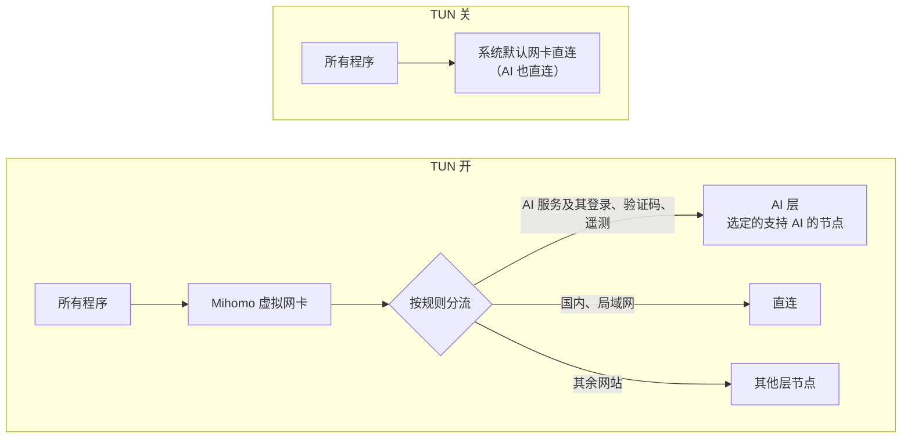

# Clash Verge AI 分流配置

给 Windows 上的 Clash Verge Rev 用的一套配置和一键脚本，做到三件事：**安全连接 AI、合理分流、安全连接代理。**

- **安全连接 AI**：所有 AI 服务，以及它们的登录、验证码、遥测，都走同一个你选定的、支持 AI 的节点；节点不可用时直接断开，不会改走别的出口。AI 域名的 DNS 跟着 AI 节点走，时区和节点所在地一致。
- **合理分流**：开 TUN 后所有流量进 Clash；国内直连，其余代理，统一用 Loyalsoldier 规则。DNS、AI、其他三层分别从所有订阅的节点里选，互不影响。
- **安全连接代理**：订阅只提供节点，改不了你的规则和 DNS；节点地址用国内加密 DNS 解析；DNS 只监听本机。

| 文件 | 用途 |
| --- | --- |
| [`Setup-ClashAI.ps1`](Setup-ClashAI.ps1) | 一键配置脚本：启动时逐项询问，生成并启用「组合配置」 |
| [`Combined-Profile.template.yaml`](Combined-Profile.template.yaml) | 组合配置模板：不用脚本、手动配置时用 |

## 快速开始

**前提**：Windows 10/11；已安装 [Clash Verge Rev](https://github.com/clash-verge-rev/clash-verge-rev)，并且至少打开过一次（本文按 2.5.8、内核 Mihomo v1.19.32 写）；至少有一个订阅链接，哪家机场都行，几家都行。网络怎么接都行。

1. **下载脚本**：在 GitHub 上打开 `Setup-ClashAI.ps1`，点「Download raw file」；或者 Code → Download ZIP 后解压。不要从网页上复制粘贴：Windows 自带的 PowerShell 5.1 只认带 BOM 的 UTF-8 脚本，复制粘贴会丢掉 BOM，中文变成乱码，脚本跑不起来。实在要粘贴，记事本「另存为」时把编码选成「带有 BOM 的 UTF-8」。
2. **导入订阅**：Clash Verge 订阅（Profiles）页 → New → Remote，粘贴订阅链接，保持自动更新。导入后**不要启用**，也**不要删除**：组合配置的节点就从这些订阅文件里读。脚本不经手订阅链接，所以这一步要手动做。
3. **运行脚本**：运行前先把脚本通读一遍。在脚本所在文件夹打开 PowerShell；正式配置要用管理员 PowerShell，打开后先 `cd` 到这个文件夹。

   ```powershell
   # 先演练：只生成并检查配置、预览各层节点，什么都不改（不需要管理员）
   powershell -ExecutionPolicy Bypass -File .\Setup-ClashAI.ps1 -DryRun

   # 正式配置（管理员 PowerShell；会提示先退出 Clash Verge）
   powershell -ExecutionPolicy Bypass -File .\Setup-ClashAI.ps1
   ```

   脚本启动后逐项询问，先预览每层会筛到哪些节点，再用内核检查生成的配置，通过了才动手，动手前全部备份。

4. **选节点、开 TUN**：打开 Clash Verge，「组合配置」已是当前配置。AI 层默认是「拒绝」，所以要**马上**到 Proxies 页给 AI 组选一个节点，再回首页打开 TUN，详见[第四步](#第四步启用与选节点)。
5. **验证**：

   ```powershell
   powershell -ExecutionPolicy Bypass -File .\Setup-ClashAI.ps1 -Verify
   ```

### 启动时会问的设置

| 设置 | 选项 | 默认 |
| --- | --- | --- |
| 用哪些订阅 | 列出订阅页里的订阅，输入序号或名字，用逗号分开；同一订阅的多个副本只选一个 | 全部 |
| AI 节点关键词 | 每个订阅分别输入，区分大小写，如 `GPT`、`新加坡\|台湾`；直接回车 = 按支持 AI 的地区 | 按地区 |
| 时区 | 新加坡、台北、东京、首尔、美国西部、美国东部、伦敦、不改 | 新加坡 |
| 「DNS 自动」用的节点 | 输入关键词；直接回车 = 新加坡、日本、台湾的 1 倍节点 | 回车 |
| 广告拦截默认 | on / off | off |
| 双出口 | yes / no；选 yes 再选网线网卡、热点网卡，确认或填写热点网关 | no |

每个设置也能用参数直接给出，给了就不再问，例如：

```powershell
powershell -ExecutionPolicy Bypass -File .\Setup-ClashAI.ps1 -Subscriptions 'all' -AiKeywords ';GPT' -TimeZone 'Singapore Standard Time' -AdBlock off -DualExit no -Yes
```

`-AiKeywords` 按所选订阅的顺序用分号隔开，空着的那一项按地区筛。另有两个参数：`-ClashDir` 指定不在默认位置的 Clash Verge 配置目录（如便携版），`-SkipSystem` 只改 Clash、不动时区和网卡。

### 它会改什么

| 位置 | 改动 |
| --- | --- |
| 系统 | 时区；自动对时（阿里云、微软 NTP）；双出口时改两块网卡的跃点数、关热点网卡的 IPv6 |
| `config.yaml` | IPv6 关；TUN 的自动路由、严格路由开；自动选择出口接口开（双出口时关） |
| `verge.yaml` | 关 DNS 覆写、关系统代理 |
| 全局扩展覆写配置 | 记住所选节点、保留假 IP 对应关系；双出口时加 `interface-name` |
| 订阅列表 | 新建或原地更新「组合配置」，并设为当前配置 |
| 规则缓存 | 缺哪个规则集下哪个；下不到就等 Clash 启动后经代理下载 |

**不会做的**：禁用任何网卡、改订阅链接、替你选 AI 节点。

**备份与恢复**：动手前，脚本把要改的文件备份到 Clash Verge 配置目录（`%APPDATA%\io.github.clash-verge-rev.clash-verge-rev`）下的 `setup-backup-时间` 文件夹。要恢复，就退出 Clash Verge，把里面的文件拷回配置目录；网卡原来的跃点数和 IPv6 设置记在同一文件夹的两个 json 里。

**验证（`-Verify`）**：TUN 开着时检查 Claude 出口地区、其他网站出口、国内直连、DNS 是否被接管、Clash 自己的境外查询出口、DNS 是否只监听本机，双出口时还查有线是否基本不发数据。TUN 关着时不测 AI 相关项，免得请求直连出去。失效保护需要手动测：AI 组临时选「拒绝」，claude.ai 应该打不开。

## 整体结构与原理



开 TUN 时，所有程序的流量先进 Clash，按规则分到三个出口；关 TUN 时流量不经过 Clash，由系统直接连网。

- **TUN 开**：Mihomo 虚拟网卡的路由优先级最高，所有程序的流量先进 Clash。Clash 按规则把流量分到 AI 层、直连或其他层，再从系统默认网卡发出。
- **TUN 关**：流量不进 Clash，AI 服务也会直连，所以用 AI 时要开着 TUN。
- **DNS**：fake-ip 模式下，走代理的域名由节点在远端解析，所以 AI 的 DNS 跟着 AI 层走；Clash 自己要查的部分按 DNS 规则表分流。
- **双出口（可选）**：网线和热点同时在线时，可以让 Clash 的出站只走热点、系统默认走网线，见[可选章节](#可选网线和手机热点双出口)。

## 目标与需求

| 目标 | 具体要求 | 实现步骤 |
| --- | --- | --- |
| 安全连接 AI | 所有 AI 服务，以及它们的登录、验证码、遥测，都走同一个选定的节点 | 第三、四步 |
| 安全连接 AI | 只能选支持 AI 的地区的节点；节点不可用时断开，不改走别的出口 | 第三、四步 |
| 安全连接 AI | AI 域名的 DNS 跟着 AI 节点走；时区和 AI 节点所在地一致，系统自动对时 | 第一、三步 |
| 合理分流 | 开 TUN 后所有流量进 Clash；国内直连，其余代理；统一用 Loyalsoldier 规则，不用订阅自带的规则 | 第二、三步 |
| 合理分流 | DNS、AI、其他三层分别从所有订阅的节点里选，互不影响；广告拦截是独立开关，默认关闭 | 第三步 |
| 安全连接代理 | 节点地址用国内加密 DNS 解析，不用明文 DNS；境外域名不交给国内 DNS 查询 | 第三步 |
| 安全连接代理 | 订阅只提供节点，改不了规则和 DNS；滤掉说明条目和直连类型的「节点」；DNS 只监听本机 | 第二、三步 |
| 好维护 | 一份配置文件；不靠后台脚本；订阅只当节点来源，不复制订阅 | 全部 |
| 可选 | 网线和手机热点同时在线时：TUN 开全部走热点，TUN 关全部走网线 | 可选章节 |

## 手动配置

不想用脚本，或者想弄懂每一步在做什么，就照下面做。下面这些值随订阅和设备而变，配置前逐一查清。

| 项目 | 例子 | 怎么查 | 用在哪里 |
| --- | --- | --- | --- |
| 每个订阅的文件名 | `AbC12xYz.yaml` | Clash Verge 订阅页，右键订阅 → 打开文件，看文件名 | 组合配置节点来源的 `path:` |
| 每个订阅的简称 | `订阅A`、`订阅B` | 自己起，会成为节点名前缀 | 节点来源的名字和前缀 |
| 说明条目的关键词 | 剩余流量、套餐到期、官网、支持AI | 看订阅里哪些条目不是真节点 | 节点来源的 `exclude-filter` |
| 能用 AI 的节点 | 机场注明「支持AI：新加坡/加拿大/美国/台湾」，或节点名带 GPT | 机场的说明优先；没有说明就按支持 AI 的地区筛 | AI 层的 `filter` |
| DNS 自动用的节点 | 新加坡、日本、台湾的 1 倍节点 | 挑稳定、不加倍计费的 | DNS 自动的 `filter` |

Clash Verge 的配置目录是 `%APPDATA%\io.github.clash-verge-rev.clash-verge-rev`，订阅文件在它下面的 `profiles` 里。网卡名和热点网关只在可选的双出口里用到。

### 第一步：时区与自动对时

这一步让时区和系统时间可靠。在**管理员** PowerShell 里运行（右键开始菜单 →「终端（管理员）」），时区 ID 换成 AI 节点所在的地区：

```powershell
Set-TimeZone -Id 'Singapore Standard Time'
Set-Service w32time -StartupType Automatic; Start-Service w32time
w32tm /config /manualpeerlist:"ntp.aliyun.com,0x8 time.windows.com,0x8" /syncfromflags:manual /update
w32tm /resync
```

常用的时区 ID：新加坡 `Singapore Standard Time`、台北 `Taipei Standard Time`、东京 `Tokyo Standard Time`、美国西部 `Pacific Standard Time`。完整列表用 `Get-TimeZone -ListAvailable` 查。

原理：浏览器会把系统时区告诉网站，时区和 AI 出口对不上是常见的风控信号，所以时区跟着 AI 层常用的节点走。NTP 只返回 UTC 时间，不会暴露时区，直连国内 NTP 即可。Windows 对时服务是按需启动的，同步完会自己停下，提示「服务没有启动」不用管。

### 第二步：Clash Verge 基础设置

这一步让 Clash 截获所有流量。界面名称以英文版为准，括号里是中文版。

| 位置 | 设置 | 值 | 为什么 |
| --- | --- | --- | --- |
| Settings → Tun Mode 旁的齿轮 | Auto Route | 开 | 让所有程序的流量先进虚拟网卡 |
| 同上 | Strict Route（严格路由） | 开 | 防止 Windows 绕过 Clash，从别的网卡发 DNS 查询 |
| 同上 | Auto Detect Interface（自动选择流量出口接口） | 开（默认） | Clash 自己的出站走系统默认网卡；双出口时要关，见可选章节 |
| Settings → Clash Setting | IPv6 | 关 | 只走 IPv4，避免 IPv6 出口不受控 |
| 同上 | DNS 覆写（DNS Settings） | 关 | DNS 由组合配置自己的规则表管 |
| 首页 | System Proxy（系统代理） | 关 | 只用 TUN 一条路，避免两套入口混用 |

然后把**全局扩展覆写配置**（Global Merge，文件是配置目录下的 `profiles\Merge.yaml`）改成：

```yaml
profile:
  store-selected: true   # 记住每一层选了哪个节点
  store-fake-ip: true    # 内核重启后保留「假 IP ↔ 域名」的对应关系
```

原理：TUN 会建一块叫 Mihomo 的虚拟网卡，路由优先级最高，所有程序的流量都先进 Clash，再按规则转发。Strict Route 堵住 Windows 绕路发 DNS 的口子。

### 第三步：组合配置

组合配置是一份本地配置文件：订阅只提供节点，分层、规则和 DNS 全由它管。订阅商因此改不了你的规则和 DNS。

**1. 导入订阅。** 订阅（Profiles）页 → New → Remote，粘贴订阅链接，保持自动更新。导入后**不要启用**它们，也不要删除：组合配置的节点就从这些订阅文件里读，内核每小时重读一次。

**2. 五个策略组。** 节点名会自动加上 `[订阅A]` 这样的来源前缀（名字是你在配置里起的），说明条目和直连类型的「节点」会被滤掉。

| 策略组 | 类型 | 里面有什么 | 管什么 |
| --- | --- | --- | --- |
| AI | 手动选择 | 第一项「拒绝」，后面只有支持 AI 的地区的节点 | 所有 AI 服务，以及它们的登录、验证码、遥测 |
| 其他 | 手动选择 | 所有订阅的全部节点 | 其余所有需要代理的网站 |
| DNS | 手动选择 | 第一项「DNS 自动」，后面是全部节点 | Clash 自己查境外域名时从哪个节点出去 |
| DNS 自动 | 自动切换（fallback） | 新加坡、日本、台湾的 1 倍节点 | 每 10 分钟测一次，用第一个能用的 |
| 广告拦截 | 开关 | PASS（关）、REJECT（开） | Loyalsoldier 的广告列表 |

**3. 规则顺序**（从上往下匹配，命中第一条就停，所以 AI 规则排最前，后面的通用规则盖不住它）：

1. 拒绝 UDP 443（HTTP/3），浏览器会立刻改用普通 HTTPS，出口更一致。
2. 自己写的 AI 清单 → AI：Net.Coffee 的 Claude 清单，加上登录、验证码、功能开关域名。
3. `geosite:anthropic` → AI。
4. 上游 AI 列表里收得太宽的 LivePerson、Envato → 其他。
5. MetaCubeX 的 AI 列表（category-ai-!cn，约 200 条）→ AI。
6. Anthropic 的 IP 段和 ASN → AI，是域名规则失效时的兜底。
7. Loyalsoldier：局域网 → 直连；广告 → 广告拦截；境外 → 其他；国内域名 → 直连；局域网 IP → 直连；Telegram IP → 其他；国内 IP → 直连。
8. 其余全部 → 其他。

**4. DNS 规则表**（和网站规则分开，从上往下匹配）：

| 顺序 | 匹配什么 | 用哪个 DNS | 从哪里发出 |
| --- | --- | --- | --- |
| 1 | AI 清单，加上你自己添加的域名 | Cloudflare / Google 加密 DNS | AI 层节点 |
| 2 | 局域网、私有域名 | 系统 DNS（路由器或热点分配的） | 直连 |
| 3 | 国内域名 | 阿里 / 腾讯加密 DNS | 直连 |
| 4 | 其余所有 | Cloudflare / Google 加密 DNS | DNS 层节点 |
| 固定例外 | 代理节点自身的地址 | 阿里 + 腾讯加密 DNS | 直连（连上节点之前只能直连） |

原理：fake-ip 模式下，程序查域名时 Clash 当场给一个假 IP，不去真的查；程序连这个假 IP 时，Clash 知道它对应哪个域名，按规则转发。走代理的域名由代理节点在远端解析，所以 Claude 的 DNS 自动跟着 AI 节点走。这张表只管 Clash 自己要真实结果的查询：直连的网站、按 IP 判断归属的网站、被排除在 fake-ip 之外的域名。节点地址用加密 DNS 查，运营商既看不到也改不了。

`fake-ip-filter` 里只放必须拿到真实地址的域名，共五类：局域网和保留域名、对时、Windows 联网检测、STUN、QQ 快捷登录，每类在配置里都有注释。别的程序在 TUN 下出问题时，再把它的域名加进去。

**5. 完整配置文件（模板）。** 把 [`Combined-Profile.template.yaml`](Combined-Profile.template.yaml) 另存为 `Combined-Profile.yaml`，再改这几处：

- 两个 `path:` 里的 `<订阅A的文件名>`、`<订阅B的文件名>` 换成你的订阅文件名。只有一个订阅，就删掉「订阅B」那段和所有 `use` 里的「订阅B」；订阅更多，就照样往下加。
- AI 层的 `filter` 默认按支持 AI 的地区筛。机场注明了哪些节点能用 AI（只有某几个地区，或名字带 GPT），就按机场的说明改窄。
- `DNS 自动` 的 `filter` 一般不用改；节点名里没有这些地名时，改成你的稳定节点的关键词。

### 第四步：启用与选节点

AI 层默认是「拒绝」，所以顺序是**先启用、马上选 AI 节点、再用 AI 服务**；顺序反了，Claude（包括 Claude Code）会连不上。

用脚本配置的，第 1、2 项已经做好：打开 Clash Verge 时「组合配置」已是当前配置，从第 3 项开始。

1. 订阅页 → New → 类型选 Local → 名称填「组合配置」→ 选择 `Combined-Profile.yaml` → Save。
2. 点一下「组合配置」启用它。
3. 立刻到 Proxies 页，在 AI 组里选一个打算长期固定用的节点：优先选机场注明支持 AI 的，地区和第一步设的时区一致。
4. 其他组选一个低倍率节点；不选就是列表里的第一个。
5. DNS 组保持「DNS 自动」。
6. 广告拦截保持 PASS（关），需要时再切到 REJECT。
7. 回首页打开 TUN。

每一层选了什么都会被记住。订阅更新后，如果选中的 AI 节点没了，AI 层会自动退回「拒绝」，重新选一个即可；这是有意设计的，避免 AI 出口悄悄换成别的节点。AI 节点尽量别换：出口 IP 一变就是风控点；真要换，时区跟着换成同一地区。

### 第五步：验证清单

全部打勾才算配置成功（脚本的 `-Verify` 会自动跑其中大部分）。涉及 Claude 的测试只在 TUN 开着时做，TUN 关时这些请求会直连出去。命令都在普通 PowerShell 里运行。

**TUN 开**

- [ ] Claude 走 AI 节点：`curl.exe -s https://claude.ai/cdn-cgi/trace` 的 `loc=` 是 AI 节点的地区
- [ ] 其他网站走其他层：`curl.exe -s https://www.cloudflare.com/cdn-cgi/trace` 是其他层节点的地区
- [ ] 国内网站直连：`curl.exe -s https://myip.ipip.net` 显示本地网络的 IP 和运营商
- [ ] DNS 被接管：`Resolve-DnsName claude.ai -Server 223.5.5.5` 返回 198.18.x.x 的假 IP
- [ ] Clash 自己的境外查询从 DNS 层出去：`Resolve-DnsName whoami.ds.akahelp.net -Type TXT` 里的 `ecs` 是 DNS 层节点的出口网段
- [ ] DNS 只监听本机：`Get-NetUDPEndpoint -LocalPort 1053` 只有 127.0.0.1
- [ ] 失效保护：AI 组临时选「拒绝」，claude.ai 打不开；测完选回节点

**TUN 关**

- [ ] 流量不经过 Clash：`Get-NetAdapter -Name Mihomo` 找不到这块虚拟网卡，上面的 cloudflare trace 显示的是本地网络的 IP

## 可选：网线和手机热点双出口

只在一台电脑同时有网线和手机热点、并且希望**开 TUN 时一切走热点、关 TUN 时一切走网线**时才做这一节，其他人跳过。脚本里选「双出口：yes」会自动做完第 1 到第 4 项。网卡名用 `Get-NetAdapter` 查，下面以 `Ethernet`、`Wi-Fi` 为例。

1. **跃点数：有线 1，Wi-Fi 500**（管理员 PowerShell）

   ```powershell
   foreach ($p in @(@{a='Ethernet'; m=1}, @{a='Wi-Fi'; m=500})) { foreach ($f in 'IPv4', 'IPv6') { Set-NetIPInterface -InterfaceAlias $p.a -AddressFamily $f -AutomaticMetric Disabled -InterfaceMetric $p.m } }
   ```

   Windows 走跃点数最小的默认路由，所以 TUN 关时全部走网线。自动跃点数按网速算，网线若只跑在 100 Mbps 会输给 Wi-Fi，所以要手动固定；500 给网关路由自带的跃点数留了余量。

2. **关掉 Wi-Fi 的 IPv6**

   ```powershell
   Disable-NetAdapterBinding -Name 'Wi-Fi' -ComponentID ms_tcpip6
   ```

   热点会给 Wi-Fi 分配公网 IPv6，而 Windows 选 IPv6 出口时先比源地址、再比跃点数，跃点数压不住它：不关的话，TUN 关时支持 IPv6 的网站会从热点出去。

3. **让 Clash 只从热点出去**：TUN 设置里关掉 Auto Detect Interface；全局扩展覆写配置里再加一行：

   ```yaml
   interface-name: Wi-Fi
   ```

   这让 Clash 发出的每个连接都钉在 Wi-Fi 网卡上，不看系统默认路由；热点断了连接直接失败，不会退回网线。

4. **DNS 规则表第 2 条**改成热点的网关地址（连上热点后运行 `ipconfig`，看 Wi-Fi 那一项的「默认网关」）：「系统 DNS」里还有网线那边的 DNS，从 Wi-Fi 发不过去。
5. **验证**

   - [ ] TUN 开：测试前后 `Get-NetAdapterStatistics -Name Ethernet` 的 SentBytes 只涨几百字节
   - [ ] TUN 关：`Find-NetRoute -RemoteIPAddress 1.1.1.1` 和 `Find-NetRoute -RemoteIPAddress 2400:3200::1` 都选 Ethernet；下载 5 MB 时 Wi-Fi 的收发计数不变

6. **注意**：热点断开时，Wi-Fi 可能自动连上别的已保存网络，TUN 模式下流量会从那个网络出去。不想这样，就把其他 Wi-Fi 改成手动连接，或用 `netsh wlan add filter` 只放行热点。

## 已知限制与注意事项

最要紧的一条：TUN 关着时，Claude 和其他流量一样直连，用 AI 时必须开 TUN。

| 情况 | 会怎样 | 怎么办 |
| --- | --- | --- |
| TUN 关时用 Claude | Claude 从本地网络的 IP 直连 | 用 AI 时保持 TUN 开着 |
| 切换 DNS 层或 AI 层的节点 | DNS 查询可能还沿用旧的加密连接一小会儿 | 在 Clash 里重新激活一下配置 |
| 内核刚启动 | 头几秒偶尔有一次节点地址解析失败 | 不用处理，随后自动恢复 |
| 机场给节点改名 | 选中的 AI 节点消失，AI 层退回「拒绝」 | 重新选节点；新名字不符合 `filter` 时顺手改 filter |
| 节点名是英文或写法特殊 | AI 层或 DNS 自动可能一个节点都没有 | 按你的节点名改 `filter`，再重新激活配置 |
| 删掉了原订阅 | 组合配置读不到节点 | 订阅永远保留，只是不启用 |
| 打开广告拦截 | 个别普通网页可能功能异常；AI 不受影响，因为 AI 规则排在广告列表前面 | 切回 PASS |
| HTTP/3 被拒绝 | 所有网站改走普通 HTTPS，理论上慢一点点 | 一般无感，不用处理 |
| NTP 没有走代理 | 无：NTP 只返回 UTC 时间，时区来自系统设置 | 时区在第一步里设好 |
| 某个程序在 TUN 下连不上，或登录、通话异常 | 它可能必须拿到真实 IP，而不是 Clash 的假 IP | 把它的域名加进 fake-ip-filter，再重新激活配置 |

## 规则来源

- [Loyalsoldier/clash-rules](https://github.com/Loyalsoldier/clash-rules)：通用分流规则（局域网、广告、境外、国内、Telegram）
- [MetaCubeX/meta-rules-dat](https://github.com/MetaCubeX/meta-rules-dat)：AI 服务列表 `category-ai-!cn`
- Net.Coffee 的「Claude Code 域名分流规则大全」：模板里内置的 Claude 域名清单
- [Clash Verge Rev](https://github.com/clash-verge-rev/clash-verge-rev)、[Mihomo](https://github.com/MetaCubeX/mihomo)
